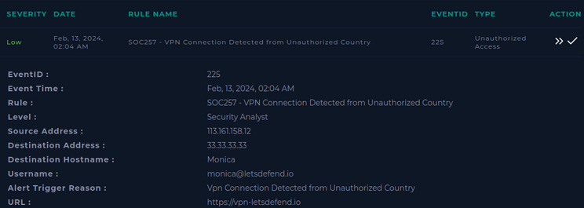
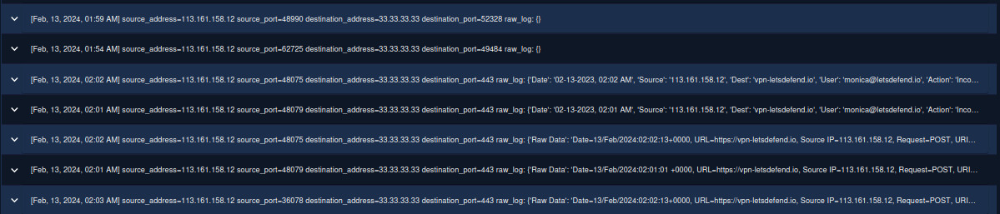
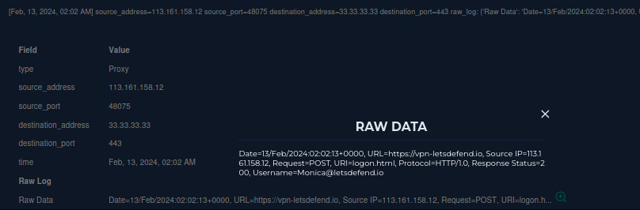
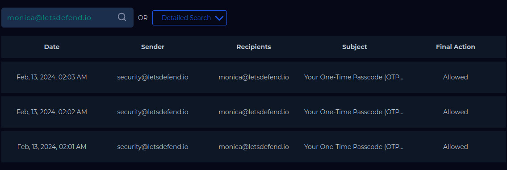
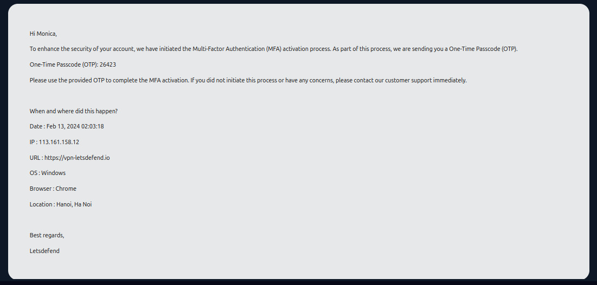
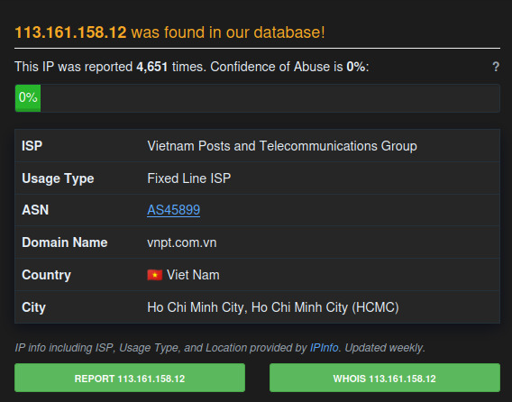
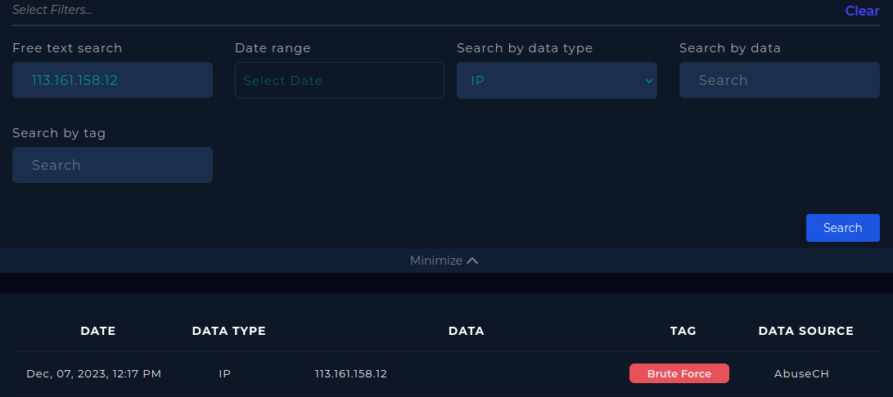

# [001] SOC257 · VPN connection from an unauthorized country
Platform: LetsDefend · Date: 2024-02-13 · Difficulty: High · Investigated: 2026-05
Verdict: True positive · Escalated: Yes
Data: simulated training environment. No real organization or user data involved.

## TL;DR
Someone in Vietnam logged in to Monica's VPN account with her valid password and triggered three OTP requests in three minutes.
True positive: MFA stopped the login, but the password is compromised.
I blocked the source IP, reset the password, revoked sessions and escalated the case.

## 1. Alert
Rule SOC257 (EventID 225), severity Low. Source: LetsDefend SIEM.



| Field | Value |
|---|---|
| Rule | SOC257 - VPN Connection Detected from Unauthorized Country |
| Event time | 13 Feb 2024, 02:04 AM |
| Source → destination | `113.161.158[.]12` → `33.33.33[.]33` (`vpn-letsdefend[.]io`) |
| User | `monica[@]letsdefend[.]io` |

## 2. Hypothesis
Either Monica is travelling (benign), or someone else is using her credentials from abroad.
If it is an attacker, I expect: no earlier activity from that IP, a bad IP reputation, and failed or unusual MFA activity.

## 3. Data sources
- LetsDefend Log Management: proxy logs for the VPN portal.
- LetsDefend Email Security: OTP emails sent to the user.
- LetsDefend Threat Intel: internal tags for the source IP.
- AbuseIPDB: public reputation of the source IP.

## 4. Investigation
**Log management:** filtered all events from `113.161.158[.]12` to the VPN host.



```log
Date=13/Feb/2024:02:02:13+0000, URL=hxxps://vpn-letsdefend[.]io, Source IP=113.161.158[.]12,
Request=POST, URI=logon.html, Protocol=HTTP/1.0, Response Status=200, Username=Monica[@]letsdefend[.]io
```



Three `POST /logon.html` requests (02:01, 02:02, 02:03), two followed by an `Incorrect OTP Code` action. Two earlier connections (01:54, 01:59) from the same IP to non-standard ports carry no payload.

**Email security:** three consecutive emails from `security[@]letsdefend[.]io` to Monica, subject *Your One-Time Passcode (OTP)*, at 02:01, 02:02 and 02:03.



Each email has a different code and the requester's details: IP `113.161.158[.]12`, Hanoi, Chrome on Windows.



**Threat intelligence:**
- AbuseIPDB: **4,651 reports**, but the current *Confidence of Abuse* is **0%**. The ISP is VNPT, a fixed-line ISP in Vietnam (AS45899).



- The LetsDefend Threat Intel tool had already tagged the IP for **Brute Force** (data source: AbuseCH).



**Technical anomalies:** `HTTP/1.0` (modern browsers use HTTP/1.1 or HTTP/2) and the legacy `logon.html` endpoint suggest a script or tool, not a person in a browser.

## 5. Findings and verdict
**True positive.** The attacker had Monica's valid password (the portal moved on to the OTP step every time) and kept retrying the second factor. MFA stopped the login.

| Time (13 Feb 2024) | Event |
|---|---|
| 01:54, 01:59 | Connections from `113.161.158[.]12` to the VPN host on high ports (no payload) |
| 02:01 | `POST /logon.html` → OTP email #1 → *Incorrect OTP Code* |
| 02:02 | `POST /logon.html` → OTP email #2 → *Incorrect OTP Code* |
| 02:03 | `POST /logon.html` → OTP email #3 |
| 02:04 | SOC257 alert fires |

| Impact check | Result |
|---|---|
| Successful VPN access | No |
| MFA bypass | No |
| Endpoint compromise / lateral movement | No evidence |

## 6. Escalation decision
**Escalated.** The login was blocked, but the password was valid, so the account is compromised. How the password leaked (phishing, reuse, infostealer) is still unknown, and the containment actions (password reset, session revocation) affect the user directly.

## 7. IOCs (defanged, also in iocs.csv)
| Type | Value | Context |
|---|---|---|
| ip | `113.161.158[.]12` | Attacker source (VNPT, AS45899) |
| email | `monica[@]letsdefend[.]io` | Compromised account (target) |
| url | `hxxps://vpn-letsdefend[.]io/logon.html` | Targeted VPN portal |

`HTTP/1.0` requests to `logon.html` are a behavioral indicator of automation, not a blockable IOC.

## 8. MITRE ATT&CK
| Tactic | Technique | Evidence |
|---|---|---|
| Initial Access | T1078 Valid Accounts | Correct password accepted; the login reached the OTP step |
| Credential Access | T1621 Multi-Factor Authentication Request Generation | 3 OTP requests in 3 minutes (email security) |
| Credential Access | T1110 Brute Force | Repeated OTP attempts; IP tagged for brute force (threat intel) |

## 9. Response and recommendations
Actions taken:
- Blocked `113.161.158[.]12` at the perimeter.
- Forced a password reset for Monica and revoked active sessions.
- Notified the user and recommended changing reused passwords.
- Added monitoring for VPN logins for the account.

Recommendations:
- Investigate *how* the password leaked (phishing, reuse, infostealer) before closing the case.
- Rate-limit and lock OTP attempts per account; alert on ≥ 3 OTP requests in 5 minutes.
- Move from email OTP to phishing-resistant MFA (FIDO2 / number matching).
- Geo-restrict the VPN portal to countries where the company operates.

## 10. What I learned
- What first looked wrong to me was `HTTP/1.0` and `logon.html`: real browsers do not log in like that. Small protocol details are a quick way to spot automation.
- The three OTP emails only made sense when I put the email logs next to the proxy logs. One source alone looked like a normal login.
- MFA stopped the attacker, but the password was already compromised, so the reset and session revocation were still necessary. Blocked does not mean closed.
- AbuseIPDB showed 4,651 reports with 0% confidence. I learned to read both numbers: lots of history, but no recent reports.
