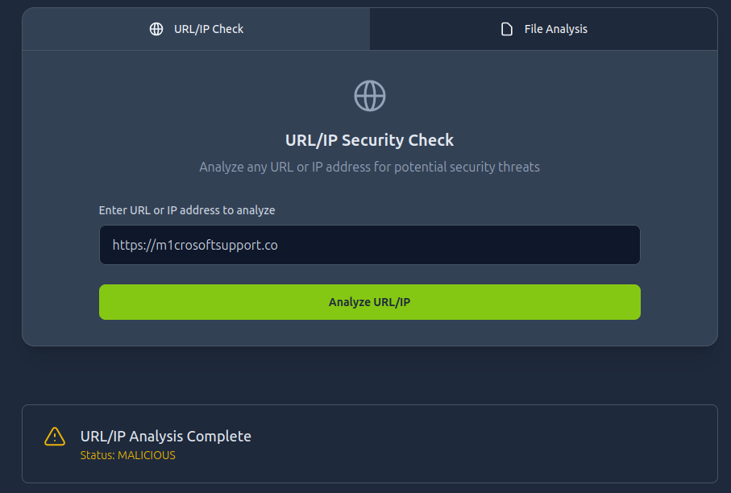
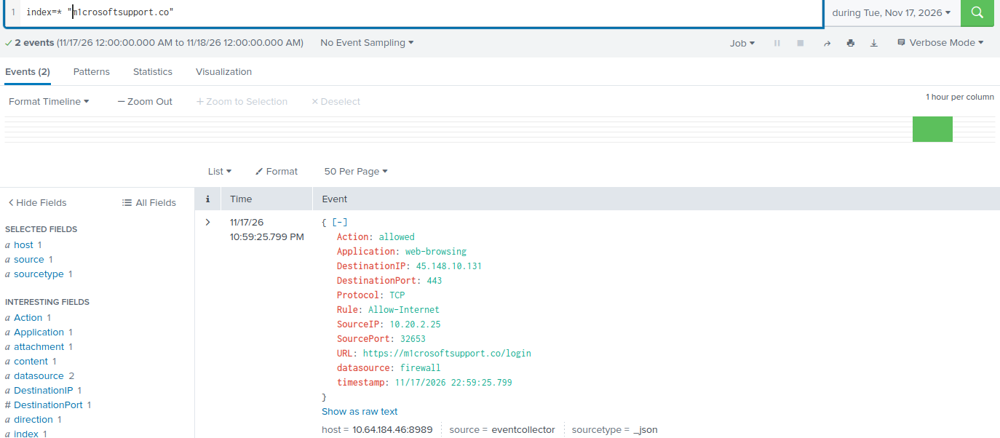
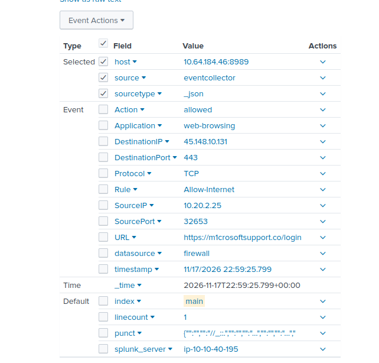
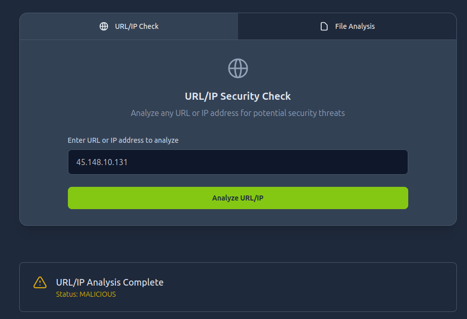
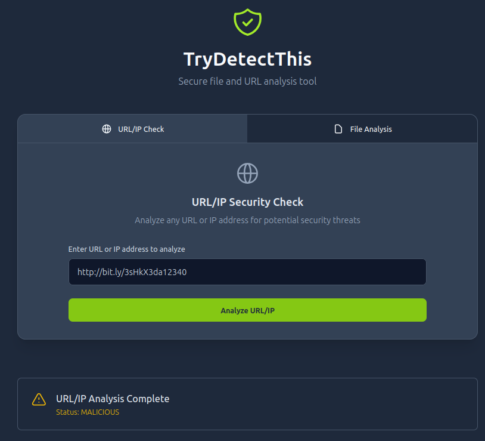
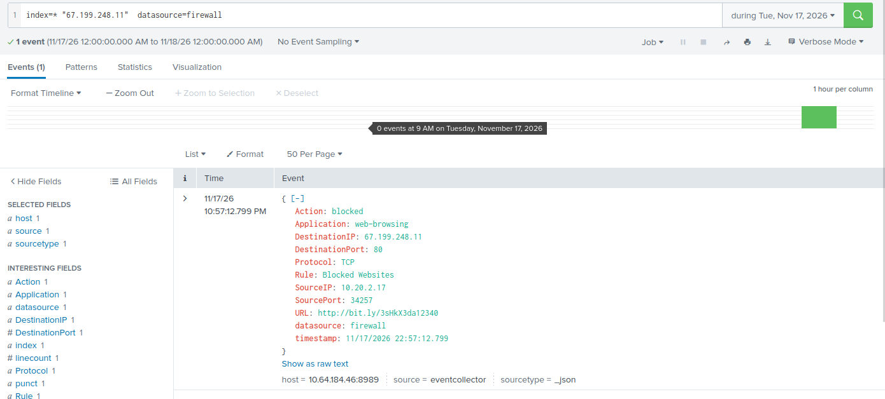
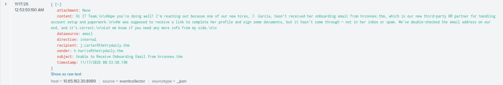
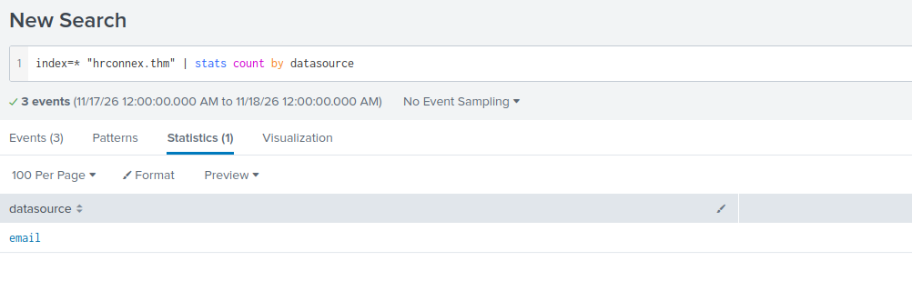

# [003] Phishing alert queue triage
Platform: TryHackMe SOC Simulator (scenario: Phishing Alert) · Date: 2026-11-17 · Difficulty: Medium
Verdict: 3 true positives (escalated) · 2 false positives (closed) · Escalated: Yes (3 of 5)
Data: simulated training environment. No real organization or user data involved.

## TL;DR
A queue of 5 alerts: 4 suspicious inbound emails and 1 blocked firewall connection.
Two were real phishing emails, and in both cases the recipient clicked the link. The firewall blocked one click (fake Amazon notice, bit.ly link) and **allowed** the other (fake Microsoft login page). The other two alerts were a legitimate onboarding email from the company's new HR provider.
I escalated the 3 true positives to L2 and closed the 2 false positives with evidence.

## 1. Alert
Five alerts on 2026-11-17, all from the SOC Simulator SIEM:

| ID | Rule | Severity | What it was | Verdict | Escalated | Key evidence |
|---|---|---|---|---|---|---|
| 8814 | Inbound Email Containing Suspicious External Link | Medium | Onboarding email from `hrconnex[.]thm` to j.garcia | False positive | No | Domain and URL CLEAN; an internal email confirms hrconnex is the new HR provider; no firewall events |
| 8815 | Inbound Email Containing Suspicious External Link | Medium | Fake Amazon delivery notice with a bit.ly link to h.harris | True positive | Yes | Full URL MALICIOUS; the firewall blocked a click from 10.20.2.17; destination IP MALICIOUS |
| 8816 | Access to Blacklisted External URL Blocked by Firewall | **High** | The blocked click from 8815 | True positive | Yes (with 8815) | Firewall `blocked`; URL and IP MALICIOUS |
| 8817 | Inbound Email Containing Suspicious External Link | Medium | Fake Microsoft sign-in alert from `m1crosoftsupport[.]co` to c.allen | True positive | Yes | Domain MALICIOUS; firewall **allowed** the click from 10.20.2.25; destination IP MALICIOUS |
| 8818 | Inbound Email Containing Suspicious External Link | Medium | Resend of the 8814 onboarding email | False positive | No | Same email as 8814; CLEAN; email events only |

**Queue summary:** 5 alerts · 3 true positives (2 incidents: 8815 + 8816 are the same one) · 2 false positives.
**Common pattern:** every phishing email impersonates a known brand and pushes the user to click a link urgently. The legitimate email has the same "action required" tone, so the subject line alone does not separate them: the URL, the destination IP and the firewall logs do.

Sections 2 to 9 focus on **8817** (the only click the firewall allowed), with **8815 + 8816** as a contrast (same attack, click blocked) and **8814 / 8818** as an example of how a false positive was ruled out.

## 2. Hypothesis
- **8817:** a credential-phishing email using a lookalike Microsoft domain. It is confirmed if the domain or its IP is malicious and the firewall shows a connection from the recipient's host. It is ruled out if both are clean and there is no traffic.
- **8814 / 8818:** an external onboarding link could be phishing. It is ruled out if the domain and URL are clean, there is no traffic, and other events show the sender is expected.

Confirming the phishing was only the first step. The real challenge was the **impact**: if an alert is a true positive, how far did the attack get? Did the user click, did the connection go through, and what could be compromised as a result?

## 3. Environment and data sources
- **Company:** The Try Daily, a fictional online publication. Internal network: `10.20.2.0/24` (everything else is external).
- **SIEM:** Splunk, with three log sources: email, firewall and WAF. There is no EDR and no proxy, so the firewall is the only source that shows whether a user clicked a link.
- **Threat intelligence:** TryDetectThis, the simulator's simulated VirusTotal (URL and IP reputation).

**Affected entities** (only the ones involved in the case):

| User | Department | Host | IP | Alerts |
|---|---|---|---|---|
| Charlotte Allen (c.allen) | Web Development | WIN-3463 | 10.20.2.25 (internal) | 8817 |
| Hannah Harris (h.harris) | Human Resources | WIN-3457 | 10.20.2.17 (internal) | 8815, 8816 |
| Julia Garcia (j.garcia) | Content | WIN-3452 | 10.20.2.8 (internal) | 8814, 8818 |

## 4. Investigation

### Deep dive: 8817, fake Microsoft sign-in alert (click allowed)
**Alert:** inbound email at 22:58:16 from `no-reply[@]m1crosoftsupport[.]co` to c.allen, subject "Unusual Sign-In Activity on Your Microsoft Account". It has no attachment and contains a link to `hxxps://m1crosoftsupport[.]co/login`. The domain swaps the "i" in Microsoft for a "1" and uses `.co`.

**1. Lure IP.** The email body claims a sign-in from "Lagos, Nigeria", IP `102[.]89[.]222[.]143`. TryDetectThis returned CLEAN. This IP is part of the lure text, not the origin of the email, so the result says nothing about the sender.

**2. Domain reputation.** TryDetectThis on `hxxps://m1crosoftsupport[.]co`: **MALICIOUS**.



**3. Did anyone click?** I searched every log source for the domain:
```spl
index=* "m1crosoftsupport.co"
```
2 events: the email (22:58:16) and a firewall event 1 min 9 s later (22:59:25):

| Field | Value |
|---|---|
| Action | **allowed** |
| Rule | Allow-Internet |
| Source | 10.20.2.25:32653 (c.allen, WIN-3463) |
| Destination | `45[.]148[.]10[.]131`:443 (TCP, HTTPS) |
| URL | `hxxps://m1crosoftsupport[.]co/login` |




**4. Destination IP reputation.** TryDetectThis on `45[.]148[.]10[.]131`: **MALICIOUS**.



### Contrast: 8815 + 8816, fake Amazon notice (click blocked)
**Alert 8815:** inbound email at 22:55:58 from `urgents[@]amazon[.]biz` to h.harris, subject "Your Amazon Package Couldn't Be Delivered – Action Required", link `hxxp://bit[.]ly/3sHkX3da12340`.

1. TryDetectThis on the domain `bit[.]ly` alone: CLEAN (it is a public URL shortener).
2. TryDetectThis on the **full URL**: **MALICIOUS**.



3. I searched the firewall logs for the link:
```spl
index=* datasource=firewall "bit.ly"
```
1 event at 22:57:12, 1 min 14 s after the email: `blocked`, rule "Blocked Websites", 10.20.2.17:34257 → `67[.]199[.]248[.]11`:80. The user clicked and the firewall stopped the connection. This event is alert **8816** (High).

4. TryDetectThis on `67[.]199[.]248[.]11`: MALICIOUS. For 8816 I pivoted on the IP to check for other traffic:
```spl
index=* "67.199.248.11" | stats count by datasource
index=* "67.199.248.11" datasource=firewall
```
Only 1 firewall event: the blocked click.



### False positive: 8814 / 8818, onboarding email from the HR provider
**Alerts:** an email from `onboarding[@]hrconnex[.]thm` to j.garcia with the subject "Action Required: Finalize Your Onboarding Profile" and a link to `hxxps://hrconnex[.]thm/onboarding/…/j.garcia` (8814). The same email arrived again 14 minutes later (8818).

1. TryDetectThis on the domain and on the full URL: both **CLEAN**.
2. I searched every event that mentions the domain:
```spl
index=* "hrconnex.thm"
```
3 emails: the original (22:52:45), the resend (22:58:44), and an **internal** email from h.harris (HR) to IT at 22:54:18. In it she says J. Garcia had not received her onboarding email from hrconnex.thm, "our new third-party HR partner".


*Screenshot from the first run of the scenario (00:53:50); the event is identical in the second run (22:54:18).*

3. I checked whether the link produced any traffic:
```spl
index=* "hrconnex.thm" | stats count by datasource
```
Only `email` (3 events): there was no firewall connection, allowed or blocked.



## 5. Findings and verdict
**8817: true positive.** A credential-phishing email from a lookalike Microsoft domain. The domain and its IP are malicious in TryDetectThis, and the firewall **allowed** a connection from c.allen's host to the fake login page 1 min 9 s after the email arrived.

**8815 + 8816: true positive, one incident.** A fake Amazon notice with a malicious bit.ly link. The URL and the destination IP are malicious in TryDetectThis, and the firewall shows a real connection attempt from h.harris's host 1 min 14 s after the email. The firewall blocked it.

**Impact:**
- **8817: high.** The connection to the fake login page went through. The user's Microsoft credentials may be compromised; whether she entered them cannot be seen from L1 data.
- **8815 + 8816: contained.** The firewall blocked the only connection attempt, and no other traffic to the IP was found. The host still needs a review because the logs available to L1 cannot rule out other activity.

**8814 + 8818: false positive.** A legitimate onboarding email from the company's new HR provider. Nothing in the case points to compromise: the URL and domain are clean in TryDetectThis and there are no malicious logs, only email events. The internal email from HR to IT confirms that this is something the company expected, and 8818 is the same email sent again.

**Timeline** (2026-11-17):

| Time | Event | Alert |
|---|---|---|
| 22:52:45 | Onboarding email from hrconnex.thm to j.garcia | 8814 |
| 22:54:18 | h.harris (HR) tells IT that j.garcia did not get the onboarding email | – |
| 22:55:58 | Fake Amazon email to h.harris | 8815 |
| 22:57:12 | h.harris clicks the bit.ly link, firewall **blocks** it | 8816 |
| 22:58:16 | Fake Microsoft email to c.allen | 8817 |
| 22:58:44 | Onboarding email resent to j.garcia | 8818 |
| 22:59:25 | c.allen opens the fake login page, firewall **allows** it | 8817 |

> I restarted the scenario once, and the simulator replays the same events with shifted times. This write-up uses the times from the second run.

## 6. Escalation decision
- **8817: escalated.** The user opened a malicious fake Microsoft login page and the firewall did not block it, so the main risk is the theft of her account credentials. L1 cannot see whether she entered them or whether anything else ran on the host, because there is no EDR. L2 has to rule that out.
- **8815: escalated.** The user clicked the link. The firewall blocked the connection, but this SIEM only has email, firewall and WAF logs. L2 has to look deeper, at the console and application logs on WIN-3457 (browser, processes), to confirm there were no other connection attempts or downloads.
- **8816: escalated together with 8815.** It is the same incident. The block prevented the connection, but the user clicked a malicious link, so the host and the user need a review.
- **8814 and 8818: closed** as false positives, with the evidence in section 5.

## 7. IOCs (defanged, also in [iocs.csv](iocs.csv))
| Type | Value | Context |
|---|---|---|
| email | `no-reply[@]m1crosoftsupport[.]co` | 8817 sender |
| domain | `m1crosoftsupport[.]co` | 8817 lookalike Microsoft domain, MALICIOUS |
| url | `hxxps://m1crosoftsupport[.]co/login` | 8817 fake login page, connection allowed |
| ip | `45[.]148[.]10[.]131` | 8817 destination IP, MALICIOUS |
| email | `urgents[@]amazon[.]biz` | 8815 sender |
| domain | `amazon[.]biz` | 8815 sender domain |
| url | `hxxp://bit[.]ly/3sHkX3da12340` | 8815/8816 shortened link, MALICIOUS, connection blocked |
| ip | `67[.]199[.]248[.]11` | 8815/8816 destination IP, MALICIOUS in TryDetectThis; shared Bitly infrastructure, do not block |

## 8. MITRE ATT&CK
| Tactic | Technique | Evidence |
|---|---|---|
| Initial Access | [T1566.002](https://attack.mitre.org/techniques/T1566/002/) Phishing: Spearphishing Link | 8815 and 8817: emails with a link to a malicious URL (section 4) |
| Reconnaissance | [T1598.003](https://attack.mitre.org/techniques/T1598/003/) Phishing for Information: Spearphishing Link | 8817: the link leads to a fake Microsoft login page (`/login`) built to collect the user's credentials (section 4) |
| Execution | [T1204.001](https://attack.mitre.org/techniques/T1204/001/) User Execution: Malicious Link | Firewall events show both users clicked: allowed for 8817, blocked for 8816 (section 4) |

## 9. Response and recommendations
**8817 (c.allen, WIN-3463):**
- Isolate WIN-3463 and segment the network until L2 reviews it.
- Reset c.allen's password and revoke her active sessions.
- Block the domain `m1crosoftsupport[.]co` and the IP `45[.]148[.]10[.]131`.
- Remove the email from all mailboxes.

**8815 + 8816 (h.harris, WIN-3457):**
- Isolate WIN-3457 as a precaution until L2 reviews it.
- Keep the block and add the specific URL to the web filter. Do not block `67[.]199[.]248[.]11`: it is shared Bitly infrastructure, and blocking it would break every bit.ly link.
- Block the sender domain `amazon[.]biz` on the email gateway, look for other recipients of the same email and remove it from their mailboxes.
- Phishing awareness training for h.harris.

**8814 + 8818:** no action.

## 10. What I learned
- Checking only the domain is not enough: `bit[.]ly` and `hrconnex[.]thm` were both CLEAN. The full URL and the destination IP are what separated the malicious link from the legitimate one.
- `67[.]199[.]248[.]11` is shared Bitly infrastructure. Blocking that IP would cut every bit.ly link, so the right control is to block the specific URL.
- An IP that appears in the body of an email is part of the lure, not the origin of the email.
- In an environment without EDR, the firewall is the only source that shows whether a user clicked.
