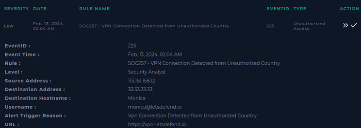
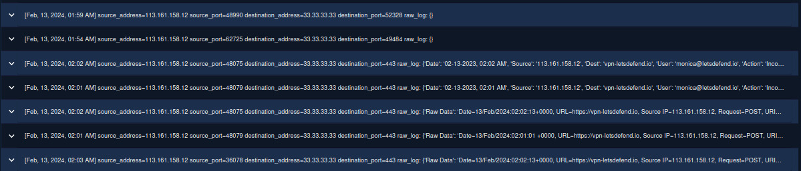
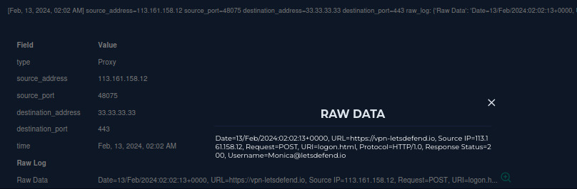
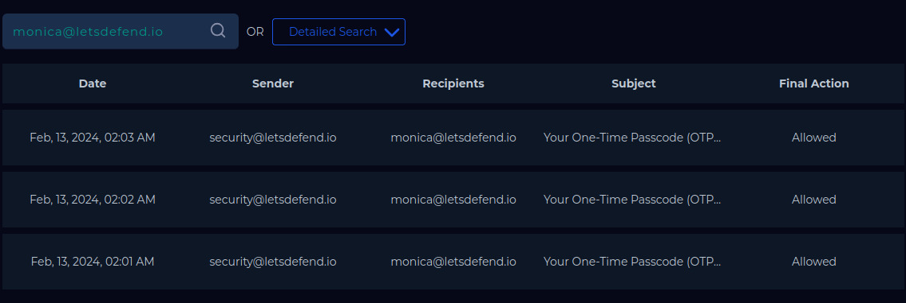
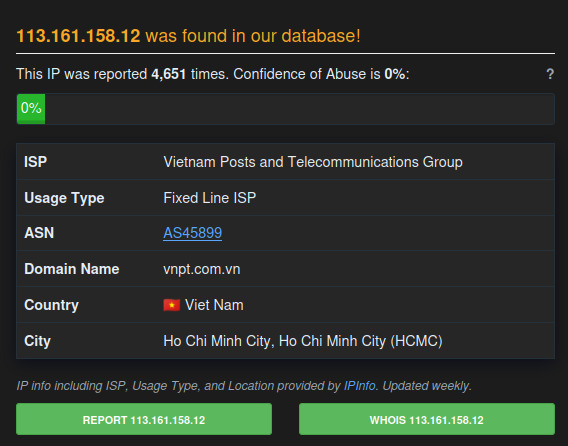

# [SOC257 · EventID 225] VPN connection from unauthorized country

LetsDefend (SOC simulator) · Alert: 13 Feb 2024 · Investigated: May 2026 · Level: Security Analyst

**Verdict: True Positive** (unauthorized access attempt with valid credentials, blocked by MFA) · Final severity: **Medium** (alert: Low)

## 1. Alert



| Field | Value |
|---|---|
| Rule | SOC257 - VPN Connection Detected from Unauthorized Country |
| Event time | 13 Feb 2024, 02:04 AM |
| Source → destination | 113.161.158.12 → 33.33.33.33 (`vpn-letsdefend.io`) |
| User | monica@letsdefend.io |

## 2. Hypothesis

Either Monica is travelling (benign), or someone else is using her credentials from abroad. If it is an attacker: expect no prior activity from that IP, a bad IP reputation, and failed or unusual MFA activity.

## 3. Investigation

**Log management:** all events from 113.161.158.12 to the VPN host:



```log
Date=13/Feb/2024:02:02:13+0000, URL=https://vpn-letsdefend.io, Source IP=113.161.158.12,
Request=POST, URI=logon.html, Protocol=HTTP/1.0, Response Status=200, Username=Monica@letsdefend.io
```



Three `POST /logon.html` requests (02:01, 02:02, 02:03), two followed by an `Incorrect OTP Code` action. Two earlier connections (01:54, 01:59) from the same IP to non-standard ports carry no payload.

**Email security:** three consecutive emails from `security@letsdefend.io` to Monica, subject *Your One-Time Passcode (OTP)*, at 02:01, 02:02 and 02:03, each with a different code and the requester's details (IP 113.161.158.12, Hanoi, Chrome on Windows).



**Threat intelligence:**
- AbuseIPDB: **4,651 reports**, but the current *Confidence of Abuse* is **0%**. The ISP is VNPT, a fixed-line ISP in Vietnam (AS45899).
- The internal threat-intel tool had already tagged the IP for brute force.



**Technical anomalies:** `HTTP/1.0` (modern browsers use HTTP/1.1 or HTTP/2) and the legacy `logon.html` endpoint suggest a script or tool, not a person in a browser.

## 4. Findings and verdict

**True Positive.** The attacker had Monica's valid password (the portal moved on to the OTP step every time) and kept retrying the second factor. MFA stopped the login.

| Time (13 Feb 2024) | Event |
|---|---|
| 01:54, 01:59 | Connections from 113.161.158.12 to the VPN host on high ports (no payload) |
| 02:01 | `POST /logon.html` → OTP email #1 → *Incorrect OTP Code* |
| 02:02 | `POST /logon.html` → OTP email #2 → *Incorrect OTP Code* |
| 02:03 | `POST /logon.html` → OTP email #3 |
| 02:04 | SOC257 alert fires |

| Impact check | Result |
|---|---|
| Successful VPN access | No |
| MFA bypass | No |
| Endpoint compromise / lateral movement | No evidence |

## 5. IOCs

Defanged.

| Type | Value | Context |
|---|---|---|
| IP | `113.161.158[.]12` | Attacker source (VNPT, AS45899) |
| User | `monica@letsdefend[.]io` | Compromised account (target) |
| URL | `hxxps://vpn-letsdefend[.]io/logon.html` | Targeted VPN portal |
| Protocol trait | `HTTP/1.0` requests to `logon.html` | Automation indicator (behavioral, not blockable alone) |

## 6. MITRE ATT&CK

| Tactic | Technique | Evidence |
|---|---|---|
| Initial Access | T1078 Valid Accounts | Correct password accepted; login reached the OTP step |
| Credential Access | T1621 Multi-Factor Authentication Request Generation | 3 OTP requests in 3 minutes |
| Credential Access | T1110 Brute Force | Repeated OTP attempts; IP previously tagged for brute force |

## 7. Response and recommendations

Actions taken:
- Blocked 113.161.158.12 at the perimeter.
- Forced a password reset for Monica and revoked active sessions.
- Notified the user and recommended changing reused passwords.
- Added monitoring for VPN logins for the account.

Recommendations:
- Investigate *how* the password leaked (phishing, reuse, infostealer) before closing the case.
- Rate-limit and lock OTP attempts per account; alert on ≥ 3 OTP requests in 5 minutes.
- Move from email OTP to phishing-resistant MFA (FIDO2 / number matching).
- Geo-restrict the VPN portal to countries where the company operates.

## 8. What I learned

- What first looked wrong to me was `HTTP/1.0` and `logon.html`: real browsers do not log in like that. Small protocol details are a quick way to spot automation.
- The three OTP emails only made sense when I put the email logs next to the proxy logs. One source alone looked like a normal login.
- MFA stopped the attacker, but the password was already compromised, so the reset and session revocation were still necessary. Blocked does not mean closed.
- AbuseIPDB showed 4,651 reports with 0% confidence. I learned to read both numbers: lots of history, but no recent reports.
